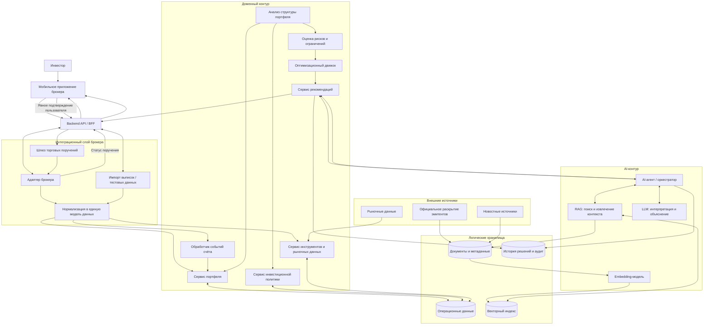
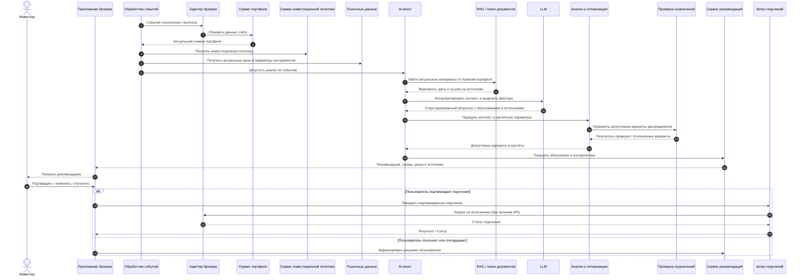

# Портфель без суеты — концептуальная архитектура MVP

> **AI-помощник долгосрочного инвестора.** Вы задаёте стратегию — помощник помогает ей следовать.
>
> Продуктовая концепция и границы MVP описаны в [`README.md`](README.md).

> **Статус:** предлагаемая архитектура. Это проектная модель, а не описание уже реализованной системы или подтверждённых интеграций.

## 1. Архитектурные цели

1. Поддерживать долгосрочную стратегию инвестора и помогать распределять новые поступления.
2. Не связывать основную бизнес-логику с конкретным брокером.
3. Разделять детерминированные финансовые расчёты и вероятностную интерпретацию LLM.
4. Обеспечивать проверяемость рекомендаций: данные, источники, даты, ограничения и причины должны быть доступны для аудита.
5. Не допускать исполнения торгового поручения без явного подтверждения инвестора.
6. Поддерживать воспроизводимые тесты и демонстрации на синтетических данных.

## 2. Границы MVP и допущения

- Первый сегмент — владельцы ИИС; в дальнейшем возможна поддержка обычных брокерских счетов и других долгосрочных продуктов.
- Архитектура брокеронезависимая. Для каждой платформы предусматривается адаптер интеграции.
- На MVP инвестор заранее задаёт инвестиционную политику и разрешённый список бумаг.
- Основные инструменты — выбранные инвестором акции и облигации. Фонды денежного рынка доступны как дополнительный вариант временного размещения свободных средств.
- MVP не подбирает новые бумаги за пределами разрешённого списка и не управляет портфелем автономно.
- MVP не прогнозирует будущую доходность ML-моделями.
- Демонстрация проводится на синтетических портфелях и событиях. Для дополнительной проверки могут использоваться обезличенные выгрузки собственного ИИС.
- Конкретные СУБД, векторное хранилище, LLM, embedding-модель, инфраструктура и брокерские API не фиксируются до проверки требований и доступности.

## 3. Компонентная архитектура

### Пояснения к компонентам

#### Канал взаимодействия и Backend API

Мобильное приложение брокера показывает событие, рекомендацию, её обоснование, альтернативы и риски. Backend API обеспечивает авторизацию, получение данных, передачу запросов и результатов между интерфейсом и внутренними сервисами. Сам помощник не должен быть привязан к UI одного брокера.

#### Интеграционный слой

Адаптер конкретного брокера переводит внешние форматы и события в единую внутреннюю модель. Он изолирует основную бизнес-логику от различий брокерских API.

Для первого прототипа вместо брокерского API допустим импорт тестовой или пользовательской выгрузки. Поддержка чтения данных и отправки торговых поручений — разные возможности: доступность обеих должна подтверждаться отдельно.

Шлюз торговых поручений отделён от AI-контурa. Он принимает только структурированное поручение после явного подтверждения инвестором, проверяет допустимость операции и передаёт её адаптеру брокера, если соответствующая интеграция доступна.

#### Доменный контур

- **Обработчик событий счёта** реагирует на пополнение, купон, дивиденд, погашение и другие значимые изменения.
- **Сервис портфеля** поддерживает актуальный снимок позиций, денежных остатков и операций.
- **Сервис инвестиционной политики** хранит заданные инвестором цели, допустимые диапазоны, разрешённые инструменты, ограничения и горизонт.
- **Сервис инструментов и рыночных данных** обеспечивает нормализованные характеристики бумаг и цены с временными метками.
- **Анализ структуры портфеля** рассчитывает фактические доли и отклонения от целевой структуры.
- **Оценка рисков и ограничений** проверяет концентрацию, ликвидность, ограничения по инструментам и другие заданные правила.
- **Оптимизационный движок** рассчитывает варианты распределения свободных средств с учётом доступных сумм, лотности, издержек, ограничений и стремления не создавать лишние сделки.
- **Сервис рекомендаций** собирает результаты расчётов, проверки ограничений и AI-объяснение в единый объект рекомендации.

#### AI-контур

- **AI-агент** оркестрирует вызовы разрешённых сервисов и собирает контекст. Набор доступных инструментов агента ограничен; прямого доступа к отправке поручений у него нет.
- **RAG** ищет релевантные фрагменты новостей, отчётности и раскрытия эмитентов, возвращая их вместе с датой, типом документа, эмитентом и ссылкой на первоисточник.
- **Embedding-модель** строит векторные представления документов и запросов для семантического поиска. Для тикеров, ISIN, дат и других точных идентификаторов дополнительно используются структурированные фильтры и/или полнотекстовый поиск.
- **LLM** интерпретирует найденные материалы в контексте конкретного портфеля и формирует объяснение, альтернативы и перечень существенных неопределённостей.

LLM не выполняет денежные расчёты, не определяет самостоятельно допустимый объём сделки и не создаёт поручение. Числа и ограничения в рекомендации должны происходить из проверяемых расчётных сервисов.

#### Логические хранилища

Архитектура предусматривает логическое разделение:

- операционные данные: портфель, остатки, операции, инструменты и инвестиционная политика;
- документы и метаданные: исходные публикации или их разрешённые копии, даты, эмитенты, типы и ссылки;
- векторный индекс: embeddings фрагментов документов;
- история решений и аудит: входные снимки, версии политик, использованные источники, расчёты, рекомендации, действия пользователя и статусы поручений.

Физическая реализация может использовать одну или несколько платформ хранения — выбор зависит от инфраструктуры брокера, требований безопасности, нагрузки и доступных технологий.

## 4. Основной поток: поступление свободных средств

## 5. Данные и частота обновления

| Данные | Примеры полей | Потенциальный источник | Частота / триггер |
|---|---|---|---|
| Счёт и позиции | Идентификатор счёта, инструмент, количество, средняя/текущая стоимость, остаток | Брокерский API или выгрузка | По событию, запросу или доступному расписанию |
| Операции и выплаты | Сделки, пополнения, купоны, дивиденды, погашения, комиссии | Брокерский API или выгрузка | По событию или при обновлении счёта |
| Параметры инструментов | Тикер, ISIN, тип, лотность, параметры облигации, дата погашения | Брокерские и внешние справочники | При изменении и по необходимости |
| Рынок | Цена, время котировки, показатели ликвидности | Биржевые / рыночные источники | Ежедневно или чаще, если доступно и нужно сценарию |
| Корпоративные события и раскрытие | Эмитент, тип события, дата публикации, период действия, ссылка | Официальные ресурсы раскрытия | По мере публикации |
| Новости | Заголовок, текст, источник, время публикации, эмитент | Новостные провайдеры | По мере публикации |
| Инвестиционная политика | Целевые доли, диапазоны, разрешённые инструменты, горизонт, ограничения | Ввод инвестора / профиль продукта | При изменении политики |

Все данные должны иметь источник, временную метку и статус качества. Система должна отличать отсутствие значения от нулевого значения и учитывать задержку обновления.

## 6. Единая модель данных

Для интеграции разных брокеров предполагается внутреннее каноническое представление. Минимальный набор сущностей:

- `AccountSnapshot` — состояние счёта на момент времени.
- `Position` — позиция по инструменту и её характеристики.
- `CashBalance` — денежные остатки с указанием валюты и доступности.
- `Transaction` — сделка или операция по счёту.
- `CashFlow` — пополнение, купон, дивиденд, погашение или иное поступление/списание.
- `Instrument` — справочная информация об инструменте, включая тикер/ISIN и лотность.
- `MarketQuote` — цена и временная метка рыночных данных.
- `CorporateEvent` — событие эмитента с датами и источником.
- `InvestmentPolicy` — цели, разрешённый набор инструментов и ограничения инвестора.
- `DocumentChunk` — фрагмент публикации с метаданными и ссылкой на источник.
- `Recommendation` — предлагаемые действия, суммы, причины, риски, альтернативы и использованные данные.
- `OrderDraft` — структурированное поручение, ожидающее явного подтверждения.
- `AuditEvent` — запись о входных данных, версии политики, расчётах и действиях пользователя.

Точные поля и формат канонической модели уточняются по результатам анализа реальных форматов брокеров.

## 7. Логика формирования рекомендации

### 7.1 Входной контекст

- актуальный снимок счёта и доступных денежных средств;
- инвестиционная политика и разрешённый список инструментов;
- оставшийся инвестиционный горизонт;
- планируемая дата использования капитала или намерение продолжить инвестирование;
- параметры инструментов и актуальность рыночных данных;
- релевантные корпоративные события, новости и раскрытие.

### 7.2 Детерминированная часть

1. Проверить полноту и актуальность входных данных.
2. Рассчитать фактические доли активов и отклонения от целевых долей.
3. Проверить заданные ограничения: разрешённый список, доли, концентрацию, ликвидность и доступность средств.
4. Рассчитать возможные покупки с учётом цены, лотности, комиссии и других издержек.
5. Сравнить варианты по соответствию стратегии, риску и количеству/стоимости операций.
6. Допустить вариант «не совершать сделку», если покупка не улучшает соответствие стратегии с учётом издержек и ограничений.

Целевая функция и набор ограничений должны быть формализованы и проверены отдельно. Ожидаемая доходность не должна выдаваться за известную величину; прогнозная оптимизация доходности не является обязательной частью MVP.

### 7.3 AI-часть

1. Найти релевантные материалы по инструментам портфеля.
2. Проверить даты, эмитентов, типы документов и ссылки на первоисточники.
3. Выделить факты и возможные факторы, которые могут иметь значение для инвестиционной политики.
4. Передать структурированный результат в контур подготовки рекомендации.
5. Сформировать понятное объяснение, не подменяя расчёты и не делая утверждений, не подтверждённых источниками.

### 7.4 Выход

Рекомендация содержит:

- предлагаемые действия или явный вывод «сделки не требуются»;
- суммы и количество лотов, рассчитанные детерминированным сервисом;
- влияние на структуру портфеля;
- причины рекомендации и связанные источники;
- существенные риски, допущения и ограничения;
- альтернативы и последствия отказа от сделки;
- время актуальности использованных данных.

## 8. Контроль качества, безопасность и отказоустойчивость

### Качество данных и безопасный отказ

- Если данные о позиции, доступных средствах или цене отсутствуют либо устарели, система не должна выдавать точную рекомендацию на их основе.
- Несогласованные сведения из разных источников должны быть явно обозначены и разрешены до расчёта.
- При недостатке релевантных документов AI должен сообщить об отсутствии достаточного контекста, а не додумывать факты.
- Существенные факты в объяснении должны сопровождаться источником и датой.

### Ограничение полномочий AI

- У AI-агента только разрешённый набор инструментов чтения и анализа.
- У AI-агента нет прямого доступа к отправке торговых поручений.
- LLM не изменяет инвестиционную политику и не расширяет разрешённый список бумаг.
- Все суммы, лоты, комиссии и проверки ограничений поступают из детерминированных сервисов.
- Внешний текст рассматривается как данные, а не как инструкции для AI-агента.

### Безопасность и данные пользователя

- Доступ к счёту и инвестиционной политике предоставляется только после надлежащей аутентификации и авторизации.
- Состав передаваемых внешним AI-сервисам данных должен быть минимизирован и согласован с требованиями брокера.
- Персональные данные, токены и секреты не включаются в промпты и журналы без необходимости и специальных мер защиты.
- Требуются управление доступом, защита каналов и хранилищ, управление секретами, аудит действий и определённые сроки хранения.

### Регуляторные и правовые вопросы

Персонализированные рекомендации по конкретным финансовым инструментам могут подпадать под специальные требования регулирования и внутренние процедуры брокера. Правовая квалификация, требования к процессу, раскрытию информации, контролю и ответственности должны быть проверены с юридической и комплаенс-функциями. Сам по себе дисклеймер не считается достаточным решением.

## 9. MVP, PoC и демонстрационный контур

### PoC

Минимальная техническая проверка должна подтвердить:

- корректность загрузки и нормализации тестовой выгрузки счёта;
- воспроизводимость расчётов портфеля и распределения средств;
- возможность находить релевантные документы и корректно ссылаться на источники;
- устойчивость к неполным, устаревшим и противоречивым данным;
- возможность сформировать структурированную рекомендацию с объяснением.

PoC не требует полноценного мобильного приложения и реальной отправки поручений.

### Демонстрация

Демо строится на подготовленных синтетических сценариях:

1. Пополнение ИИС при отклонении фактических долей от целевых.
2. Поступление купонов и дивидендов.
3. Небольшой остаток свободных средств, при котором покупка может быть нецелесообразна из-за лотности и издержек.
4. Приближение планируемой даты использования капитала и рассмотрение инструментов с меньшей рыночной волатильностью, включая фонды денежного рынка.
5. Негативное корпоративное событие, требующее показать источник, неопределённость и необходимость пересмотра предпосылок, но не автоматической продажи.

Синтетические сценарии обеспечивают повторяемость демонстрации и не зависят от времени реальных выплат или доступности брокерского API. Дополнительная проверка на обезличенной выгрузке собственного ИИС возможна при соблюдении требований безопасности.

## 10. План проверки первой гипотезы

**Гипотеза:** помощник сокращает время на анализ портфеля и распределение новых средств без нарушения стратегии и риск-ограничений.

Первый персональный эксперимент планируется провести на собственном ИИС при ближайшем пополнении. На одном снимке портфеля сравниваются текущий подход (подготовка выписок/скриншотов и диалог с универсальной AI-моделью) и процесс с MVP.

- Основная метрика — активное время от уведомления о поступлении средств до готового к оценке решения.
- Текущая оценка — не менее часа.
- Целевое ожидание — около 15 минут с помощником.
- Качество проверяется на соответствие рекомендаций инвестиционной политике и ограничениям.

Это первая персональная проверка работоспособности и полезности, а не исследование рыночного спроса.

## 11. Что остаётся определить

- Юридическая модель предоставления персонализированных рекомендаций.
- Контракт и возможности интеграции с конкретными брокерами.
- Каноническая схема данных на основе реальных примеров брокерских выгрузок/API.
- Требования к свежести котировок и документов для каждого типа сценария.
- Конкретные LLM и embedding-модель после оценки качества, безопасности, стоимости и доступности.
- Механизм поиска документов, критерии релевантности и тестовый набор для оценки RAG.
- Формальная целевая функция оптимизации и набор жёстких ограничений.
- Пороговые значения, при которых система должна рекомендовать не совершать сделку.
- Метрики качества и процедура экспертной проверки рекомендаций.
- Требования к инфраструктуре, размещению данных, аудиту и мониторингу.

## 12. Архитектурный принцип

**AI интерпретирует и объясняет. Алгоритмы рассчитывают и проверяют. Инвестор принимает решение.**
